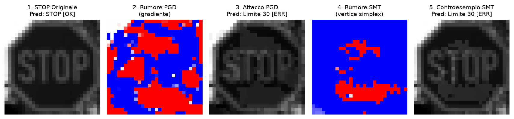

# Robustness and Formal Verification of Neural Networks on GTSRB

[ 🇮🇹 Leggi in italiano ](README.md)

Project for the **Introduction to Machine Learning** course (A.Y. 2025/2026), University of Trieste.

Comparison between a standard model (ERM) and a robust model (*adversarial training* with PGD) on 5 traffic sign classes from GTSRB (STOP, Yield/Priority, Speed Limit 30, Speed Limit 50, No Entry), evaluating empirical robustness under **PGD** attacks and exact formal certification using the SMT solver **Marabou**.



## Documents

- **Technical report (PDF)**: [`ENGLISH_REPORT.pdf`](ENGLISH_REPORT.pdf)
- **Presentation (PDF)**: [`presentazione.pdf`](presentazione.pdf)

## Setup

This project uses [`uv`](https://docs.astral.sh/uv/) to manage the virtual environment and dependencies defined in `pyproject.toml`:

```bash
uv sync
```

## Usage

The entire experimental pipeline (data inspection, training, PGD attacks, confusion matrices, and formal verification with Marabou) is self-contained and reproducible in the notebook [`main.ipynb`](main.ipynb):

```bash
uv run jupyter notebook main.ipynb
```
