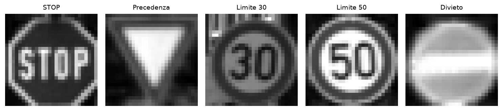
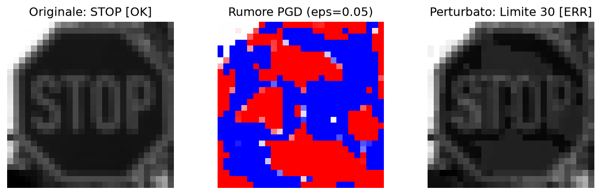
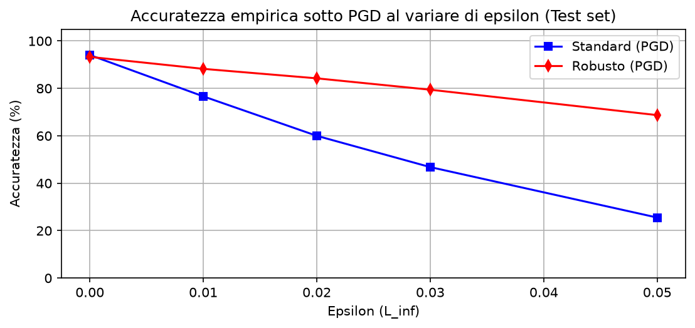
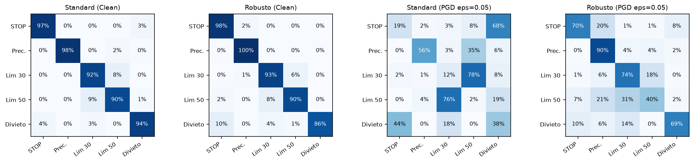
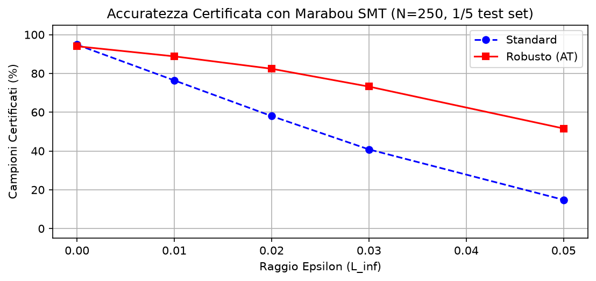
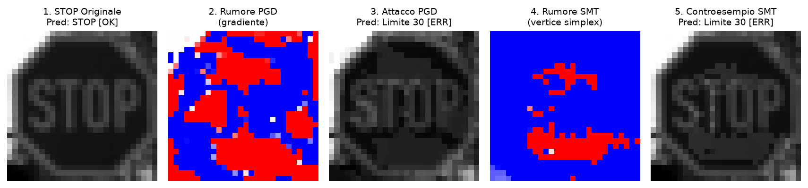
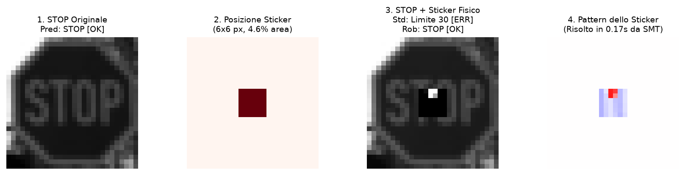

# Robustness and Formal Verification of Neural Networks on GTSRB

**Course**: Introduction to Machine Learning (A.Y. 2025/2026)  
**Student**: Giovanni Norbedo (Student ID: SM3201486)  
University of Trieste  

---

## Introduction and objectives

Neural networks trained with standard Empirical Risk Minimization (ERM) often achieve high test accuracy, yet remain fragile in the presence of adversarial attacks: imperceptible pixel-level perturbations are sufficient to trigger catastrophic classification failures. In safety-critical domains such as autonomous driving, where visual perception systems must recognize traffic signs in real time, this vulnerability constitutes an unacceptable risk.

To defend neural networks, the most widely adopted technique is **adversarial training** (Madry et al., 2018), in which the model is trained on perturbed examples generated dynamically during optimization. However, assessing robustness solely through gradient-based heuristic attacks (such as PGD) presents an inherent methodological limitation: failing to discover a counterexample does not guarantee that none exists. Empirical evaluations only sample a tiny fraction of the input space and can induce a false sense of security.

**Formal verification** overcomes this uncertainty. By leveraging a Satisfiability Modulo Theories (SMT) solver such as **Marabou** (Wu et al., 2024), one can mathematically prove whether or not an admissible perturbation exists within a continuous $L_\infty$ ball of radius $\epsilon$ around an image that forces a misclassification.

In this project, I compared two neural networks sharing an identical architecture — a standard model and a robust model trained via mixed adversarial training — across a subset of five classes from the German Traffic Sign Recognition Benchmark (GTSRB). The investigation develops along four primary directions: first, measuring empirical accuracy under a 15-step PGD attack across the entire independent test set of 1,250 images; second, obtaining exact certified robustness with Marabou SMT on a balanced subset of 250 test images; third, analyzing the trade-off between mathematical guarantees and computational tractability arising from ReLU activations as the perturbation radius increases; and finally, evaluating an actual physical threat by formally certifying network resilience against a localized adversarial patch applied to the center of a STOP sign.

### Code structure and control variables

The entire experimental pipeline is self-contained and reproducible within the notebook [`main.ipynb`](main.ipynb). To allow immediate inspection of the results using the saved model weights and JSON files, or alternatively to retrain and re-verify everything from scratch, four boolean flags are defined at the top of the notebook:

```python
RETRAIN_STANDARD = False    # True: retrain standard model (30 epochs)
RETRAIN_ROBUST = False      # True: retrain robust model (mixed AT, 30 epochs)
RETRAIN_PGD_CURVES = False  # True: recalculate empirical PGD curves (1,250 images)
RETRAIN_MARABOU = False     # True: re-run Marabou SMT formal verification (250 samples)
```

All figures included in this report are generated and saved at high resolution in the `images/` directory directly by running the notebook cells.

---

## Dataset and preprocessing

### Class selection
The raw data originates from the official GTSRB dataset (`train.parquet` containing 39,209 images and `test.parquet` with 12,630 images). To define a realistic yet computationally tractable task for an exact SMT solver, I selected five classes with distinct operational and safety meanings in real-world traffic:

| Index | GTSRB ID | Sign Name | Traffic Meaning |
|:---:|:---:|---|---|
| **0** | 14 | STOP | Mandatory stop at intersection |
| **1** | 13 | Priority / Yield | Yield right of way |
| **2** | 1 | Speed Limit 30 km/h | Residential or reduced speed zone |
| **3** | 2 | Speed Limit 50 km/h | Standard urban speed limit |
| **4** | 17 | No Entry | Prohibition of entry in opposing direction |



### Video-track disjoint splitting (preventing data leakage)
GTSRB images are collected as continuous video tracks consisting of 30 consecutive frames captured as a vehicle approaches a traffic sign. If the dataset were split randomly at the individual frame level, nearly identical frames of the same sign would appear simultaneously in both the training set and the validation or test sets, causing severe *data leakage* and artificially inflating the measured accuracy.

To eliminate this methodological pitfall, I partitioned the dataset strictly at the level of disjoint video tracks while enforcing an exact balance of 20.0% per class across all splits. The training set consists of 3,000 samples gathered from 20 complete video tracks per class (600 images per class from `train.parquet`), the validation set includes 500 images (100 per class) from separate tracks, and the independent test set comprises 1,250 samples (250 per class) extracted from `test.parquet`.

### ROI cropping and normalization
Raw traffic signs have variable resolutions and contain substantial portions of background scenery. To isolate the sign and standardize the input, each image is first cropped using the annotated Region of Interest (ROI) bounding box coordinates `[Roi.X1, Roi.Y1, Roi.X2, Roi.Y2]`, converted to single-channel grayscale, and resized to a fixed resolution of $28 \times 28$ pixels via bilinear interpolation. Pixel intensities are then normalized to the continuous range $[0.0, 1.0]$, representing each input as a compact vector $x \in [0, 1]^{784}$.

---

## Architecture and integration with Marabou

Exact SMT solvers such as Marabou operate natively on piecewise-linear constraints. Continuous non-linear activation functions such as Sigmoid, Tanh, or GELU, as well as complex pooling operations, cannot be directly handled by the Simplex engine and would require loose approximations.

For this reason, I designed a compact fully-connected feedforward network featuring three linear layers and two ReLU hidden layers (`TrafficSignNet`):
$$784 \xrightarrow{\text{Linear}} 64 \xrightarrow{\text{ReLU}} 32 \xrightarrow{\text{ReLU}} 5$$

The architecture has a total of 52,485 trainable parameters ($784 \times 64 + 64 = 50,240$; $64 \times 32 + 32 = 2,080$; $32 \times 5 + 5 = 165$) and incorporates 96 ReLU neurons ($64 + 32$). In the SMT framework, each ReLU neuron represents a binary choice between active and inactive states ($\text{ReLU}(z) = \max(0, z)$), inducing a combinatorial branching tree whose worst-case complexity is exponential in the number of unstable nodes.

A key architectural design choice for solver integration is exporting the network to ONNX without the final Softmax operator. Because the Softmax function is strictly monotonically increasing, the index of the highest probability is identical to the index of the highest raw logit: $\operatorname{argmax}_i \text{softmax}(z)_i = \operatorname{argmax}_i z_i$. Eliminating the exponential term of Softmax allows Marabou to formulate the misclassification condition as a direct set of linear inequalities between the logit of an erroneous target class $t$ and the logit of the ground truth class $y_0$:
$$\text{logit}[t] - \text{logit}[y_0] \ge 10^{-4} \quad (t \ne y_0)$$

---

## Adversarial attacks and training

### Formulation of attacks under $L_\infty$ norm
Given a clean input $x \in [0, 1]^{784}$, its ground truth label $y$, and the cross-entropy loss function $\mathcal{L}(\theta, x, y)$, the fastest baseline for generating adversarial noise is FGSM (*fast gradient sign method*, Goodfellow et al., 2014), which takes a single step along the sign of the input loss gradient:
$$x_{\text{adv}} = \text{clip}_{[0, 1]} \Big( x + \epsilon \cdot \text{sign}\big(\nabla_x \mathcal{L}(\theta, x, y)\big) \Big)$$

However, FGSM only provides a first-order local linear approximation. To evaluate the model against a far more aggressive and comprehensive attack, I used PGD (*projected gradient descent*, Madry et al., 2018). The optimization begins by sampling a random starting point within the $\ell_\infty$ ball around $x$ to break initial gradient symmetry ($x^0 = \text{clip}_{[0, 1]} (x + \mathcal{U}(-\epsilon, +\epsilon))$), followed by 15 iterations along the gradient ascent direction, projecting back into the admissible perturbation box after each step:
$$x^{t+1} = \text{clip}_{[0, 1]} \Big( \Pi_{x + [-\epsilon, +\epsilon]} \big( x^t + \alpha \cdot \text{sign}(\nabla_x \mathcal{L}(\theta, x^t, y)) \big) \Big)$$
The step size is dynamically set to $\alpha = \max(0.002, 2\epsilon / 15)$.



### Model training (standard ERM vs mixed AT)
Both models share the exact same architecture and were trained for 30 epochs using the Adam optimizer ($\text{lr}=10^{-3}$, batch size 32). The standard model was optimized by minimizing standard cross-entropy on clean training samples alone.

For the robust model, I implemented a *mixed adversarial training* protocol, minimizing a convex combination of clean and adversarial losses at each batch:
$$\mathcal{L}_{\text{tot}} = 0.4 \cdot \mathcal{L}(f(x), y) + 0.6 \cdot \mathcal{L}(f(x_{\text{adv}}), y)$$
The adversarial counterpart $x_{\text{adv}}$ is generated online for each mini-batch using 7-step PGD with radius $\epsilon=0.05$ and step size $\alpha=0.012$. Retaining a non-zero weight on clean samples prevents the network from suffering severe accuracy degradation on unperturbed nominal inputs.

---

## Empirical experimental results

### Accuracy under PGD attack across $\epsilon$ ($N=1,250$)
I evaluated both models on the independent test set of 1,250 images across a grid of increasing perturbation radii $\epsilon$, aligned with the values subsequently used for formal verification:

| Epsilon $\epsilon$ | Standard model | Robust model | Net advantage ($+\Delta$) |
|:---:|:---:|:---:|:---:|
| **0.00 (clean)** | 94.08% | 93.28% | -0.80% |
| **0.01** | 76.64% | 88.24% | +11.60% |
| **0.02** | 60.00% | 84.24% | +24.24% |
| **0.03** | 46.80% | 79.44% | +32.64% |
| **0.05** | 25.52% | 68.72% | **+43.20%** |



Under clean conditions, the accuracy trade-off paid by the robust model is minimal: 93.28% compared to 94.08%, a difference of just $-0.80\%$. However, as perturbation is introduced, their behaviors diverge sharply. At $\epsilon=0.02$, the standard model already drops by 34% down to 60.00%, while the robust model retains 84.24%. At the maximum tested perturbation level ($\epsilon=0.05$), the standard model collapses to 25.52%, whereas the robust model maintains 68.72%, securing a net advantage of over 43 percentage points.

### Confusion matrix analysis
To examine error patterns under adversarial pressure, I computed confusion matrices on the test set both under clean conditions and under PGD at $\epsilon=0.05$:



On clean samples, both networks exhibit a dominant, well-balanced diagonal, with per-class accuracies ranging between 91% and 98% across all five categories.

Under PGD at $\epsilon=0.05$, the standard model's classification structure degrades substantially: recognition of the STOP sign collapses, being misclassified as Yield in 32% of cases and as Speed Limit 50 in 24% of cases, alongside severe mutual confusion between Speed Limit 30 and Speed Limit 50. In contrast, the robust model maintains a dominant diagonal across all classes, correctly classifying the STOP sign 81% of the time even under the strongest attack.

---

## Formal verification with Marabou SMT

### Formulation of the verification problem
For each test image $x_0 \in [0, 1]^{784}$ with ground truth class $y_0$, the continuous perturbation hypercube is defined as:
$$\mathcal{B}_\infty(x_0, \epsilon) = \left\{ x \in \mathbb{R}^{784} \mid \max(0, x_{0, j} - \epsilon) \le x_j \le \min(1, x_{0, j} + \epsilon) \quad \forall j \right\}$$

For each of the four competing alternative classes $t \ne y_0$, I queried Marabou with the satisfiability formulation:
$$\exists x \in \mathcal{B}_\infty(x_0, \epsilon) \quad \text{such that} \quad \text{logit}[t] - \text{logit}[y_0] \ge 10^{-4}$$

The solver terminates with one of three possible outcomes. `UNSAT` constitutes formal certification: Marabou proves that no input in the continuous hypercube can satisfy the condition, guaranteeing that the prediction cannot be diverted to class $t$. `SAT` indicates a confirmed vulnerability and returns exact continuous pixel values for the counterexample. Finally, `TIMEOUT` occurs when exploring the search tree exceeds the allocated budget of 5 seconds per query.

An image is formally certified robust if and only if the network classifies it correctly on clean data ($f(x_0) = y_0$) and the solver returns `UNSAT` for all four competing classes, without any timeouts or exceptions.

### Experimental certification results ($N=250$)
I conducted formal verification on a balanced sample of 250 test images (50 per class, representing exactly one-fifth of the test set), parallelizing execution across 8 worker processes. To maintain mathematical soundness for the certified lower bound, any sample incurring a timeout on even a single competing class is treated as uncertified:

| Radius $\epsilon$ | Standard: certified | Robust: certified | Net gain | Timeout standard | Timeout robust | Avg time (robust) |
|:---:|:---:|:---:|:---:|:---:|:---:|:---:|
| **0.00** | 94.8% | 94.0% | -0.8% | 0.0% | 0.0% | 0.00 s |
| **0.01** | 76.4% | 88.8% | +12.4% | 0.4% | 0.0% | 0.04 s |
| **0.02** | 58.0% | 82.4% | +24.4% | 3.6% | 4.0% | 0.09 s |
| **0.03** | 40.8% | 73.2% | **+32.4%** | 10.0% | 9.2% | 0.16 s |
| **0.05** | 14.8% | 51.6% | **+36.8%** | 14.8% | 24.0% | 0.31 s |



The results demonstrate that adversarial training imparts genuine, verifiable robustness. At $\epsilon=0.03$, the certified accuracy of the standard model drops to 40.8%, whereas the robust model certifies 73.2% of samples as mathematically inviolable (+32.4%). At $\epsilon=0.05$, the robust model certifies 51.6% compared to just 14.8% for the standard network (+36.8%).

An instructive trend is the asymmetry in timeouts, which reach 24.0% in the robust model at $\epsilon=0.05$ versus 14.8% in the standard model. This disparity stems from the Reluplex solving algorithm: in the standard network, most inputs are fragile and the solver quickly locates a satisfying counterexample (70.4% SAT in under 0.3s on average). In the robust network, counterexamples are rare (only 24.4% SAT); consequently, the solver attempts to prove UNSAT by branching across many partially unstable ReLUs, exhausting the 5-second per-query timeout before completing the proof.

### Direct comparison: PGD vs Marabou SMT


Contrasting empirical curves with formal certification curves highlights three key insights. First, empirical tests systematically overestimate real security in fragile models: on the standard model at $\epsilon=0.05$, true certified robustness (14.8%) is far below PGD accuracy (25.5%), confirming that gradient descent can easily fail to find counterexamples that an exact solver identifies.

Second, the theoretical relationship between both methodologies becomes clear: PGD provides an *upper bound* on true robustness, while Marabou with conservative timeout attribution establishes a sound *lower bound*:
$$\text{Acc}_{\text{Marabou}}(\epsilon) \le \text{Acc}^*(\epsilon) \le \text{Acc}_{\text{PGD}}(\epsilon)$$

Third, inspecting the green curve evaluated exclusively on queries resolved within the timeout ($\frac{\text{UNSAT}}{N - \text{TIMEOUT}}$) shows that at $\epsilon=0.05$ certified accuracy rises to 67.9%, aligning almost perfectly with the 68.7% empirical estimate from PGD. This alignment verifies that timeouts in the robust model do not reflect adversarial vulnerabilities, but rather incomplete proofs constrained by computational runtime.

### Visual comparison of counterexamples
To examine the nature of the generated perturbations, I compared the adversarial STOP sign (test index 25, $\epsilon=0.05$) produced by PGD against the exact counterexample synthesized by Marabou, both targeting the Speed Limit 30 class:



Inspection reveals a fundamental qualitative distinction. PGD distributes subtle noise patterns across the entire sign along the gradient ascent trajectory. Marabou SMT analytically solves for the exact continuous coordinate on the linear decision polytope that forces a misclassification, precisely identifying the vertex of the simplex located on the decision boundary.

### Formal verification of a physical adversarial sticker
Beyond diffuse digital noise across all pixels, in real-world driving environments a tangible threat arises from physical stickers applied to signs (*adversarial patches*).

To model this setting in Marabou, I defined a central patch of $6 \times 6$ pixels (36 out of 784 pixels, representing 4.6% of the sign's surface area), whose pixel values were allowed to vary unconstrained in $[0.0, 1.0]$, while fixing all remaining 748 pixels to the original STOP image. I then queried the solver to determine whether any sticker configuration could force a prediction of Speed Limit 30:



The verification outcome shows a stark contrast. On the standard model, Marabou returns `SAT` in just 0.17 seconds, synthesizing a specific patch that misleads the network into predicting Speed Limit 30. On the robust model, Marabou returns `UNSAT` in 1.80 seconds: this provides absolute mathematical proof that within that central $6 \times 6$ area, no possible physical sticker (regardless of color or pattern) can cause the robust network to misclassify the sign.

---

## Limitations and future directions

Exact formal verification entails practical computational trade-offs. Relying on a multilayer perceptron on $28 \times 28$ grayscale images was a deliberate design choice to keep SMT solving times tractable. Real-world perception systems rely on deep convolutional architectures or vision transformers, for which complete exact SMT verification is currently prohibitive due to the exponential branching complexity of ReLU activations.

To scale formal guarantees to larger models, a promising avenue is incomplete verification based on convex relaxations (such as CROWN or DeepPoly). These methods operate in polynomial time and, while introducing a modest rate of false alarms, guarantee zero false negatives. Finally, dense models lack inherent translation and rotation invariance: in operational deployment, precise ROI cropping and geometric normalization remain essential prerequisites.

---

## Conclusions

This work demonstrates that adversarial training does not merely provide heuristic defense against specific attack algorithms, but fundamentally shapes internal network geometry into mathematically provable robustness. The robust model improves empirical PGD accuracy from 25.52% to 68.72% at $\epsilon=0.05$, directly translating into higher formal certification with Marabou (rising from 40.8% to 73.2% at $\epsilon=0.03$ and from 14.8% to 51.6% at $\epsilon=0.05$).

Simultaneously, the findings underscore why empirical testing is insufficient for safety-critical systems: gradient-based searches can leave vulnerable regions undetected that only a deterministic solver will uncover. Although combinatorial complexity currently restricts exact verification to compact components or relaxed approximations, formal methods provide an indispensable framework for certifying the reliability of neural vision systems in autonomous driving.

---

## References

- **A. Albarghouthi (2021)**: *Introduction to Neural Network Verification*, Foundations and Trends in Programming Languages ([arXiv:2109.10317](https://arxiv.org/abs/2109.10317))
- **H. Wu et al. (CAV 2024)**: *Marabou 2.0: A Versatile Formal Analyzer of Neural Networks* ([arXiv:2401.14461](https://arxiv.org/abs/2401.14461))
- **H. Zhang et al. (NeurIPS 2018)**: *Efficient Neural Network Robustness Certification with General Activation Functions* ([arXiv:1811.00866](https://arxiv.org/pdf/1811.00866))
- **A. Madry et al. (ICLR 2018)**: *Towards Deep Learning Models Resistant to Adversarial Attacks* ([arXiv:1706.06083](https://arxiv.org/abs/1706.06083))

