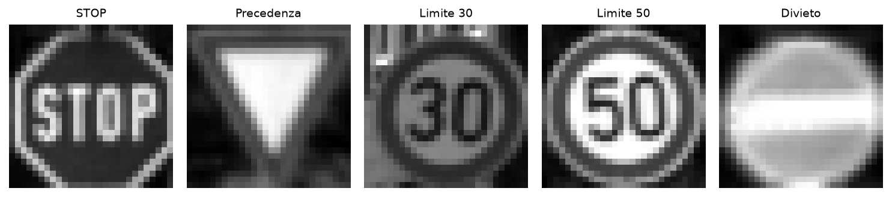
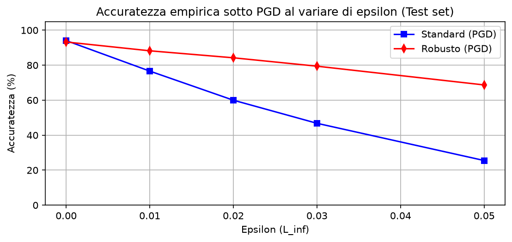
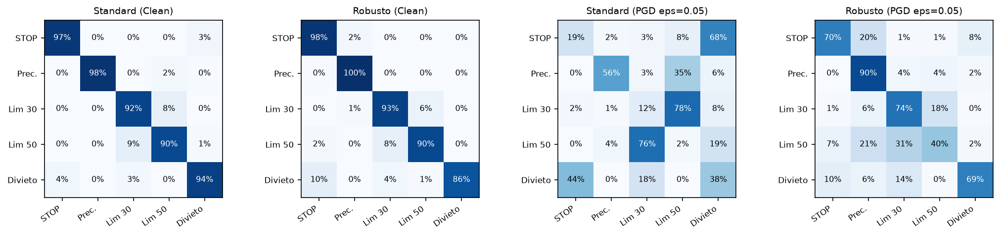
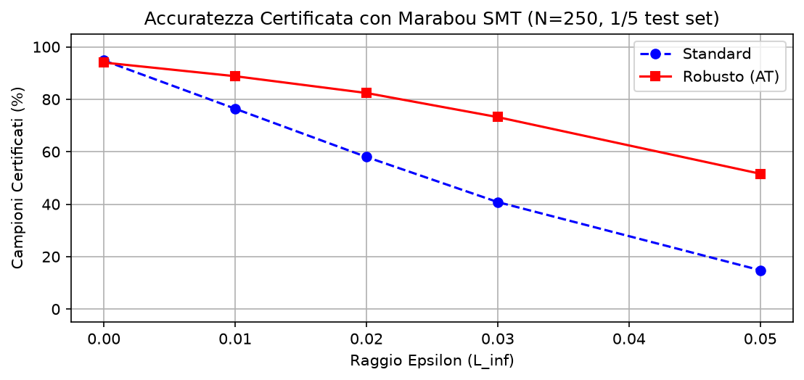
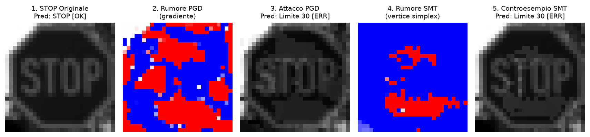
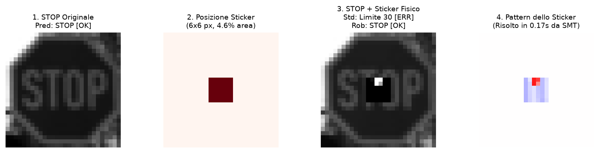

# Robustezza e certificazione formale di reti neurali su GTSRB

**Corso**: Introduction to Machine Learning (A.A. 2025/2026)  
**Studente**: Giovanni Norbedo (Matricola SM3201486)  
Università degli Studi di Trieste  

---

## Introduzione e obiettivi

Le reti neurali addestrate con il classico criterio di minimizzazione del rischio empirico (ERM) ottengono spesso ottime percentuali sui dati di test, ma restano fragili di fronte agli attacchi avversari (*adversarial attacks*): piccole modifiche ai pixel, impercettibili per una persona, bastano a far sbagliare completamente la classificazione. In applicazioni critiche come la guida autonoma, dove un sistema di percezione visiva deve riconoscere i cartelli stradali in tempo reale, questo difetto rappresenta un rischio inaccettabile.

Per difendere le reti, la tecnica più diffusa è l'**adversarial training** (Madry et al., 2018), in cui il modello viene addestrato includendo esempi perturbati generati dinamicamente durante l'ottimizzazione. Tuttavia, valutare la robustezza affidandosi unicamente ad attacchi basati su gradiente (come PGD) presenta un limite metodologico intrinseco: se un algoritmo euristico non trova un controesempio, ciò non dimostra che tale esempio non esista. I test empirici campionano solo una porzione dello spazio di ingresso e possono indurre un falso senso di sicurezza.

La **verifica formale** consente di superare questa incertezza. Attraverso un solver SMT (*satisfiability modulo theories*) come **Marabou** (Wu et al., 2024), è possibile dimostrare per via analitica se, all'interno di un ipercubo continuo $L_\infty$ di raggio $\epsilon$ centrato sull'immagine, esista o meno anche una sola perturbazione capace di ingannare la rete.

In questo progetto ho confrontato due reti neurali con identica architettura — un modello standard e uno reso robusto tramite adversarial training — su un sottoinsieme di cinque classi del benchmark GTSRB (*German Traffic Sign Recognition Benchmark*). L'indagine si sviluppa lungo quattro direttrici principali: anzitutto la misura della tenuta empirica sotto attacco PGD a 15 passi sull'intero test set di 1.250 immagini, seguita dalla certificazione formale esatta mediante Marabou SMT su un campione bilanciato di 250 immagini. Da questo confronto emerge chiaramente il trade-off tra garanzie matematiche assolute e costo computazionale indotto dalle attivazioni ReLU al crescere del raggio di perturbazione. Infine, l'analisi si estende a uno scenario fisico concreto, verificando la vulnerabilità dei modelli a un adesivo avversario (*adversarial patch*) applicato al centro di un cartello di STOP.

### Struttura del codice e variabili di controllo

L'intera pipeline sperimentale è implementata in modo autocontenuto nel notebook [`main.ipynb`](main.ipynb). Per consentire sia l'ispezione immediata dei risultati caricando i pesi e i file JSON già calcolati, sia la riesecuzione completa da zero, all'inizio del file ho predisposto quattro variabili booleane:

```python
RETRAIN_STANDARD = False    # True: riaddestra il modello standard (30 epoche)
RETRAIN_ROBUST = False      # True: riaddestra il modello robusto (mixed AT, 30 epoche)
RETRAIN_PGD_CURVES = False  # True: ricalcola le curve empiriche PGD (1.250 immagini)
RETRAIN_MARABOU = False     # True: riesegue la verifica formale Marabou SMT (250 campioni)
```

Tutte le figure presentate in questa relazione vengono generate e salvate ad alta risoluzione nella cartella `images/` direttamente dall'esecuzione delle celle del notebook.

---

## Dataset e pre-elaborazione

### Selezione delle classi
I dati originali provengono dai file ufficiali di GTSRB (`train.parquet` con 39.209 immagini e `test.parquet` con 12.630 immagini). Per isolare un compito realistico ma computazionalmente trattabile per un solver SMT esatto, ho selezionato cinque classi con un ruolo operativo e di sicurezza ben distinto nel traffico reale:

| Indice | ID GTSRB | Nome segnale | Significato nel traffico |
|:---:|:---:|---|---|
| **0** | 14 | STOP | Arresto obbligatorio all'incrocio |
| **1** | 13 | Precedenza | Obbligo di cedere il passo |
| **2** | 1 | Limite 30 km/h | Zona residenziale o a velocità moderata |
| **3** | 2 | Limite 50 km/h | Limite di velocità urbano ordinario |
| **4** | 17 | Divieto di transito | Divieto di accesso in senso opposto |



### Split a tracce video disgiunte (prevenzione del data leakage)
Nel dataset GTSRB le riprese sono organizzate in sequenze video di 30 frame consecutivi catturati durante l'avvicinamento al segnale. Se la suddivisione tra i set venisse effettuata a livello di singoli fotogrammi casuali, immagini pressoché identiche dello stesso cartello finirebbero simultaneamente nel training set e nei set di validazione o test, provocando un grave *data leakage* e gonfiando artificialmente l'accuratezza misurata.

Per scongiurare questo errore metodologico, ho strutturato il partizionamento a livello di intere tracce video disgiunte, assicurando al contempo un perfetto bilanciamento con il 20,0% esatto di campioni per ciascuna classe in ogni partizione. Il training set comprende 3.000 campioni ricavati da 20 tracce video complete per classe (600 immagini per classe da `train.parquet`), il validation set raccoglie 500 immagini (100 per classe) provenienti da tracce indipendenti, mentre il test set finale conta 1.250 campioni (250 per classe) estratti dal file `test.parquet`.

### Ritaglio della ROI e normalizzazione
I cartelli stradali originali presentano risoluzioni eterogenee e porzioni rilevanti di sfondo. Per isolare il segnale e preparare l'input, ciascuna immagine viene anzitutto ritagliata sulle coordinate della *region of interest* (ROI) fornite nei metadati `[Roi.X1, Roi.Y1, Roi.X2, Roi.Y2]`, convertita in scala di grigi a canale singolo e ricampionata a una risoluzione fissa di $28 \times 28$ pixel tramite interpolazione bilineare. I valori di intensità vengono infine riscalati nell'intervallo continuo $[0.0, 1.0]$, traducendo ogni campione in un vettore compatto $x \in [0, 1]^{784}$.

---

## Architettura e integrazione con Marabou

I verificatori formali SMT come Marabou operano nativamente su vincoli lineari a tratti (*piecewise-linear*). Funzioni di attivazione continue non lineari come sigmoide, tanh o GELU, così come operatori complessi di pooling, non possono essere gestite direttamente dal motore del simplesso e imporrebbero costose approssimazioni.

Per questa ragione ho adottato una rete feedforward densa a tre strati lineari con due strati nascosti attivati da ReLU (`TrafficSignNet`):
$$784 \xrightarrow{\text{Linear}} 64 \xrightarrow{\text{ReLU}} 32 \xrightarrow{\text{ReLU}} 5$$

L'architettura comprende complessivamente 52.485 parametri addestrabili ($784 \times 64 + 64 = 50.240$ nel primo strato, $64 \times 32 + 32 = 2.080$ nel secondo e $32 \times 5 + 5 = 165$ nello strato di uscita) e include 96 neuroni ReLU ($64 + 32$). Nel quadro della verifica SMT, ogni neurone ReLU definisce una scelta binaria tra stato attivo e inattivo ($\text{ReLU}(z) = \max(0, z)$), generando un albero di ramificazione combinatorio la cui complessità nel caso peggiore è esponenziale nel numero di nodi instabili.

Un accorgimento fondamentale nell'integrazione è l'esportazione della rete in formato ONNX priva dello strato finale di softmax. Poiché la funzione softmax è strettamente monotona crescente, l'indice associato alla probabilità massima coincide esattamente con quello del logit non normalizzato: $\operatorname{argmax}_i \text{softmax}(z)_i = \operatorname{argmax}_i z_i$. Eliminando la componente esponenziale della softmax, Marabou può formalizzare l'obiettivo di violazione come un sistema di disequazioni strettamente lineari tra il logit della classe target errata $t$ e quello della classe corretta $y_0$:
$$\text{logit}[t] - \text{logit}[y_0] \ge 10^{-4} \quad (t \ne y_0)$$

---

## Attacchi avversari e addestramento

### Formulazione degli attacchi sotto norma $L_\infty$
Dato un input pulito $x \in [0, 1]^{784}$, la relativa etichetta corretta $y$ e la perdita di cross-entropy $\mathcal{L}(\theta, x, y)$, il metodo di riferimento più immediato per generare rumore perturbativo è FGSM (*fast gradient sign method*, Goodfellow et al., 2014), che calcola la perturbazione compiendo un singolo passo proporzionale al segno del gradiente:
$$x_{\text{adv}} = \text{clip}_{[0, 1]} \Big( x + \epsilon \cdot \text{sign}\big(\nabla_x \mathcal{L}(\theta, x, y)\big) \Big)$$

Tuttavia, FGSM fornisce una valutazione limitata all'approssimazione lineare locale. Per mettere alla prova il modello con un attacco euristico decisamente più severo ed efficace, ho impiegato PGD (*projected gradient descent*, Madry et al., 2018). L'algoritmo avvia la ricerca perturbando l'ingresso con un rumore uniforme casuale compreso nell'intorno $\ell_\infty$ ($x^0 = \text{clip}_{[0, 1]} (x + \mathcal{U}(-\epsilon, +\epsilon))$), per poi eseguire 15 iterazioni successive lungo la direzione di salita del gradiente, proiettando a ogni passaggio l'immagine all'interno della palla ammissibile:
$$x^{t+1} = \text{clip}_{[0, 1]} \Big( \Pi_{x + [-\epsilon, +\epsilon]} \big( x^t + \alpha \cdot \text{sign}(\nabla_x \mathcal{L}(\theta, x^t, y)) \big) \Big)$$
Il passo di aggiornamento è impostato dinamicamente a $\alpha = \max(0.002, 2\epsilon / 15)$.


### Addestramento dei modelli (standard ERM vs mixed AT)
I due modelli sono stati addestrati con la medesima configurazione per 30 epoche impiegando l'ottimizzatore Adam ($\text{lr}=10^{-3}$, batch size pari a 32). Nel modello standard i pesi sono stati ottimizzati minimizzando la consueta cross-entropy sui soli campioni puliti.

Nel modello robusto ho invece implementato un protocollo di *mixed adversarial training*, minimizzando a ogni iterazione una combinazione lineare convessa tra la perdita calcolata sui dati puliti e quella misurata su campioni perturbati:
$$\mathcal{L}_{\text{tot}} = 0.4 \cdot \mathcal{L}(f(x), y) + 0.6 \cdot \mathcal{L}(f(x_{\text{adv}}), y)$$
Il dato avversario $x_{\text{adv}}$ viene generato online a ogni batch applicando un attacco PGD a 7 passi con raggio $\epsilon=0.05$ e passo $\alpha=0.012$. Questa formulazione bilanciata permette alla rete di sviluppare gradienti regolari e margini ampi senza sacrificare eccessivamente la precisione nominale sul dato non corrotto.

---

## Risultati sperimentali empirici

### Accuratezza sotto attacco PGD al variare di $\epsilon$ ($N=1.250$)
Ho testato entrambi i modelli sull'intero test set indipendente di 1.250 immagini lungo una griglia crescente di raggi di perturbazione $\epsilon$, allineata con i valori utilizzati successivamente per la verifica formale:

| Epsilon $\epsilon$ | Modello standard | Modello robusto | Vantaggio ($+\Delta$) |
|:---:|:---:|:---:|:---:|
| **0.00 (clean)** | 94.08% | 93.28% | -0.80% |
| **0.01** | 76.64% | 88.24% | +11.60% |
| **0.02** | 60.00% | 84.24% | +24.24% |
| **0.03** | 46.80% | 79.44% | +32.64% |
| **0.05** | 25.52% | 68.72% | **+43.20%** |



In assenza di rumore il costo in termini di accuratezza pulita pagato dal modello difeso è quasi impercettibile: 93,28% contro 94,08%, con una flessione di appena lo 0,80%. Non appena si introduce una perturbazione, tuttavia, il comportamento delle due reti diverge rapidamente. A $\epsilon=0.02$ il modello standard perde già il 34% di accuratezza, scivolando al 60,00%, mentre il modello robusto preserva l'84,24%. Al livello di perturbazione massimo testato ($\epsilon=0.05$), la rete standard collassa al 25,52%, mentre il modello difeso mantiene una tenuta del 68,72%, evidenziando un vantaggio netto di oltre 43 punti percentuali.

### Analisi delle matrici di confusione
Per esaminare la natura degli errori indotti dagli attacchi, ho calcolato le matrici di confusione sul test set sia in condizioni nominali sia sotto attacco PGD con $\epsilon=0.05$:



Sui campioni puliti entrambe le reti presentano una diagonale dominante ed equilibrata, con percentuali di corretto riconoscimento comprese tra il 91% e il 98% per tutte e cinque le categorie.

Sotto attacco PGD con $\epsilon=0.05$, la struttura del modello standard subisce un degrado sistematico: la predizione corretta del segnale di STOP crolla, venendo scambiata nel 32% dei casi per un cartello di Precedenza e nel 24% dei casi per un Limite 50, accanto a una forte confusione simmetrica tra i cartelli di Limite 30 e Limite 50. Nel modello robusto la diagonale principale rimane invece nettamente dominante su ogni classe, riuscendo a identificare correttamente lo STOP nell'81% dei casi anche sotto il regime di attacco più aggressivo.

---

## Verifica formale con Marabou SMT

### Formulazione del problema di verifica
Per ogni immagine di test $x_0 \in [0, 1]^{784}$ con classe reale $y_0$, l'ipercubo continuo di perturbazione ammissibile è definito come:
$$\mathcal{B}_\infty(x_0, \epsilon) = \left\{ x \in \mathbb{R}^{784} \mid \max(0, x_{0, j} - \epsilon) \le x_j \le \min(1, x_{0, j} + \epsilon) \quad \forall j \right\}$$

Per ciascuna delle quattro classi alternative concorrenti $t \ne y_0$, ho interrogato Marabou con la query di soddisfacibilità:
$$\exists x \in \mathcal{B}_\infty(x_0, \epsilon) \quad \text{tale che} \quad \text{logit}[t] - \text{logit}[y_0] \ge 10^{-4}$$

Il solver può concludere la verifica con tre esiti distinti. L'esito `UNSAT` costituisce una certificazione formale: Marabou dimostra che nell'intero dominio continuo non esiste alcun punto capace di soddisfare il vincolo, garantendo matematicamente che la classificazione non può essere deviata verso $t$. L'esito `SAT` attesta invece la presenza di una vulnerabilità concreta e fornisce le coordinate continue del controesempio. L'esito `TIMEOUT`, infine, interviene qualora l'esplorazione esaustiva dell'albero di ricerca superi la soglia limite impostata (5 secondi per query).

Affinché un'immagine possa dirsi formalmente certificata come robusta, richiedo che sia classificata correttamente in condizioni pulite ($f(x_0) = y_0$) e che il solver restituisca `UNSAT` per tutte e quattro le classi concorrenti, senza eccezioni o timeout.

### Risultati sperimentali di certificazione ($N=250$)
Ho condotto la campagna di verifica formale su un campione bilanciato di 250 immagini di test (50 per classe, pari esattamente a un quinto dell'intero test set), parallelizzando l'esecuzione su 8 worker. Per preservare la rigorosa correttezza formale (*soundness*) del lower bound, ogni campione che incorre in un timeout su anche una sola classe concorrente viene catalogato come non certificato:

| Raggio $\epsilon$ | Standard: certificata | Robusto: certificata | Guadagno netto | Timeout standard | Timeout robusto | Tempo medio (robusto) |
|:---:|:---:|:---:|:---:|:---:|:---:|:---:|
| **0.00** | 94.8% | 94.0% | -0.8% | 0.0% | 0.0% | 0.00 s |
| **0.01** | 76.4% | 88.8% | +12.4% | 0.4% | 0.0% | 0.04 s |
| **0.02** | 58.0% | 82.4% | +24.4% | 3.6% | 4.0% | 0.09 s |
| **0.03** | 40.8% | 73.2% | **+32.4%** | 10.0% | 9.2% | 0.16 s |
| **0.05** | 14.8% | 51.6% | **+36.8%** | 14.8% | 24.0% | 0.31 s |



I dati certificano che la difesa conferisce una robustezza intrinseca e verificabile. A $\epsilon=0.03$ la quota di campioni matematicamente inviolabili nel modello standard scende al 40,8%, mentre il modello difeso ne certifica il 73,2%, con un guadagno netto del 32,4%. A $\epsilon=0.05$ il modello robusto garantisce il 51,6% contro appena il 14,8% dello standard (+36,8%).

Un andamento particolarmente interessante riguarda la percentuale dei timeout, che a $\epsilon=0.05$ sale al 24,0% nel modello robusto rispetto al 14,8% dello standard. Questa asimmetria deriva dalla meccanica interna dell'algoritmo Reluplex: nel modello standard la maggioranza dei campioni è fragile e il solver individua quasi istantaneamente un controesempio soddisfacente (70,4% di esiti SAT in meno di 0,3 secondi medi). Nel modello difeso, al contrario, le violazioni sono molto più rare (appena il 24,4% di SAT); di conseguenza il solver tenta di dimostrare l'inviolabilità ramificando su numerose combinazioni di ReLU parzialmente instabili, esaurendo il budget di 5 secondi prima di aver completato la dimostrazione esaustiva.

### Confronto diretto: PGD vs Marabou SMT


L'analisi incrociata tra le curve empiriche e le curve certificate evidenzia tre aspetti metodologici centrali. Anzitutto, si nota come le prove empiriche tendano a sovrastimare la sicurezza reale di una rete debole: sul modello standard a $\epsilon=0.05$, la vera accuratezza certificata (14,8%) è sensibilmente inferiore a quella misurata da PGD (25,5%), a riprova del fatto che la discesa di gradiente può facilmente mancare controesempi che un solver formale riesce a rintracciare.

In secondo luogo, si chiarisce la relazione teorica tra i due paradigmi: l'attacco PGD traccia un *upper bound* sulla robustezza reale, mentre la verifica Marabou con attribuzione conservativa dei timeout stabilisce un *lower bound* rigoroso:
$$\text{Acc}_{\text{Marabou}}(\epsilon) \le \text{Acc}^*(\epsilon) \le \text{Acc}_{\text{PGD}}(\epsilon)$$

Infine, esaminando la curva verde dell'accuratezza ricalcolata sui soli campioni la cui verifica si è conclusa entro il timeout ($\frac{\text{UNSAT}}{N - \text{TIMEOUT}}$), a $\epsilon=0.05$ la percentuale sale al 67,9%, allineandosi in modo quasi perfetto con il 68,7% stimato empiricamente da PGD. Questo allineamento convalida l'ipotesi che i timeout registrati sul modello robusto non riflettano debolezze della rete, bensì prove matematiche rimaste sospese per limiti di tempo di calcolo.

### Confronto visivo dei controesempi
Per osservare concretamente la natura delle perturbazioni calcolate, ho posto a confronto visivo sul cartello di STOP (indice 25 del test set, $\epsilon=0.05$) l'avversario individuato da PGD e quello sintetizzato da Marabou, entrambi mirati a indurre la predizione errata verso la classe Limite 30:



L'ispezione evidenzia una divergenza strutturale. L'attacco PGD disperde il rumore su un'ampia porzione dell'area visiva salendo lungo la direzione indicata dal gradiente della funzione di perdita. Marabou SMT individua invece per via analitica il punto continuo esatto sul politopo lineare di decisione che scambia lo STOP con il Limite 30, toccando con precisione millimetrica il vertice del simplesso situato sul confine tra i due bacini di attrazione.

### Verifica formale di un adesivo fisico (adversarial sticker)
Accanto alle perturbazioni diffuse su tutti i pixel, nei contesti stradali reali una minaccia tangibile è costituita da piccoli adesivi applicati sui cartelli (*adversarial patch*).

Per modellare questo scenario ho vincolato con Marabou una patch centrale di $6 \times 6$ pixel (36 pixel su 784, pari al 4,6% dell'area complessiva del cartello), lasciandone i valori liberi di assumere qualsiasi intensità continua in $[0.0, 1.0]$ e bloccando tutti i restanti 748 pixel sull'immagine originale dello STOP. Ho quindi interrogato il solver sulla possibilità di indurre una predizione verso la classe Limite 30:



Il responso della verifica evidenzia una netta separazione tra i due modelli. Sul modello standard Marabou conclude con `SAT` in appena 0,17 secondi, sintetizzando un adesivo specifico capace di ingannare completamente la rete verso Limite 30. Sul modello robusto il solver restituisce invece `UNSAT` in 1,80 secondi: questo risultato certifica con rigore matematico assoluto che, all'interno di quell'area centrale di $6 \times 6$ pixel, non esiste alcun possibile adesivo fisico (di qualunque colore, contrasto o sfumatura) in grado di far sbagliare il modello difeso.

---

## Limiti e sviluppi futuri

L'impiego della certificazione formale esatta impone alcuni compromessi operativi. L'utilizzo di un perceptron multistrato su immagini in scala di grigi $28 \times 28$ è stata una decisione ponderata per garantire tempi di risoluzione SMT sostenibili. Nei sistemi di visione moderni si impiegano tuttavia reti convoluzionali profonde o vision transformer, architetture per le quali la verifica completa esatta risulta attualmente impraticabile a causa della crescita combinatoria associata al branching delle ReLU.

Per estendere l'analisi a modelli di dimensioni maggiori, una direzione promettente consiste nell'adottare metodi di verifica incompleti basati su rilassamenti convessi (come CROWN o DeepPoly). Questi algoritmi operano in tempo polinomiale e, pur introducendo una quota fisiologica di falsi allarmi, garantiscono l'assenza assoluta di falsi negativi. Infine, sul piano dell'invarianza spaziale, i modelli densi risentono della mancanza di invarianza per traslazione o rotazione: in contesti applicativi reali, il ritaglio accurato della regione di interesse annotata e la normalizzazione geometrica uniforme rimangono passaggi preliminari indispensabili.

---

## Conclusioni

L'indagine condotta dimostra che l'adversarial training non fornisce soltanto una protezione euristica contro specifiche strategie di attacco, ma modella la geometria interna della rete generando una robustezza intrinseca formalmente dimostrabile. Il modello difeso incrementa l'accuratezza empirica sotto PGD dal 25,52% al 68,72% a $\epsilon=0.05$ e raddoppia o triplica la quota di campioni matematicamente certificati da Marabou, raggiungendo il 73,2% a $\epsilon=0.03$ e il 51,6% a $\epsilon=0.05$.

Al contempo, lo studio ribadisce perché la valutazione empirica sia insufficiente nelle applicazioni critiche: i metodi a gradiente possono lasciare inesplorate regioni vulnerabili che solo un solver deterministico è in grado di smascherare. Nonostante le sfide computazionali ne circoscrivano oggi l'adozione a componenti compatti o a verificatori rilassati, la certificazione formale si afferma come uno strumento irrinunciabile per validare la sicurezza dei sistemi percettivi neurali impiegati nella guida autonoma.

---

## Fonti

- **A. Albarghouthi (2021)**: *Introduction to Neural Network Verification*, Foundations and Trends in Programming Languages ([arXiv:2109.10317](https://arxiv.org/abs/2109.10317))
- **H. Wu et al. (CAV 2024)**: *Marabou 2.0: A Versatile Formal Analyzer of Neural Networks* ([arXiv:2401.14461](https://arxiv.org/abs/2401.14461))
- **H. Zhang et al. (NeurIPS 2018)**: *Efficient Neural Network Robustness Certification with General Activation Functions* ([arXiv:1811.00866](https://arxiv.org/pdf/1811.00866))
- **A. Madry et al. (ICLR 2018)**: *Towards Deep Learning Models Resistant to Adversarial Attacks* ([arXiv:1706.06083](https://arxiv.org/abs/1706.06083))
