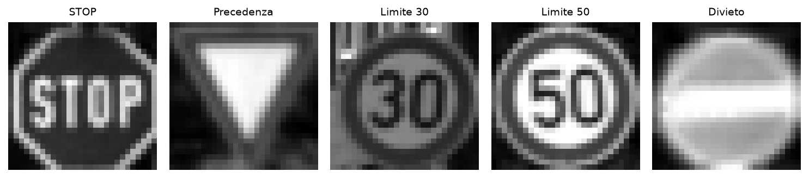
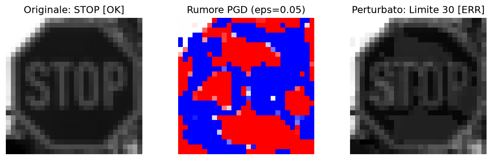
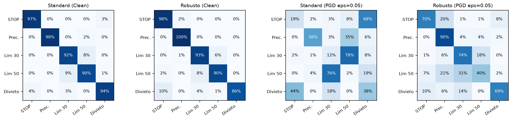
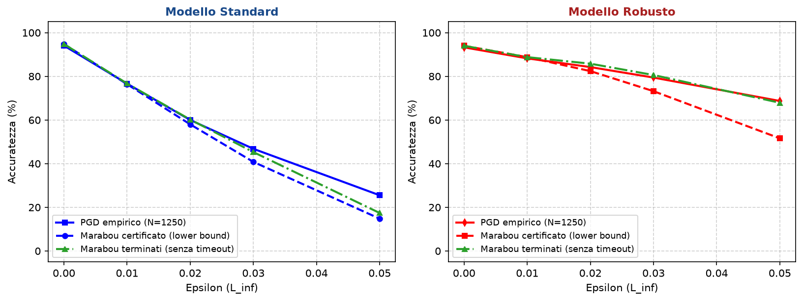
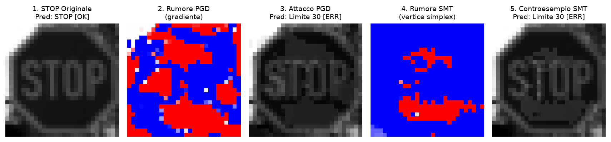
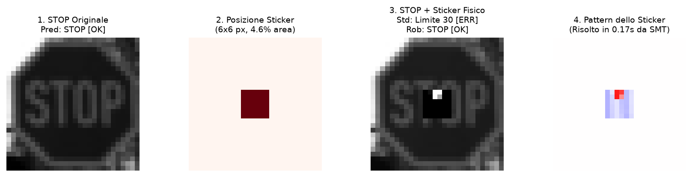

<!-- footer: "Giovanni Norbedo" -->

<!-- _class: title-slide -->

# Robustezza e verifica formale di reti neurali

## Confronto tra adversarial training e Marabou SMT su GTSRB

 

**Giovanni Norbedo**  
Introduction to Machine Learning, 2025/2026  
*Università degli Studi di Trieste*

---

## Vulnerabilità avversaria e limiti dei test

In compiti critici come la guida autonoma, le reti neurali devono essere affidabili.

- **Vulnerabilità avversaria ($L_\infty$)**: modifiche minime e impercettibili sui pixel ingannano sistematicamente le reti standard.
- **Il limite del testing empirico**: attacchi euristici come **PGD** esplorano il gradiente locale. Se non trovano un controesempio, non garantiscono che la rete sia sicura.
- **Verifica formale esatta**: con il solver SMT **Marabou** ([Wu et al., 2024](https://arxiv.org/abs/2401.14461); [Albarghouthi, 2021](https://arxiv.org/abs/2109.10317)), dimostriamo matematicamente l'assenza di controesempi all'interno dell'ipercubo continuo $[x_0 - \epsilon, x_0 + \epsilon]$.

---

## Dataset GTSRB e modello piecewise-linear

  

- **5 classi critiche**: STOP, Precedenza, Limite 30, Limite 50, Divieto.
- **Split bilanciato a tracce video disgiunte**: 3.000 train (600/classe), 500 val, 1.250 test. Evita il *data leakage* tra frame consecutivi.
- **MLP piecewise-linear (`TrafficSignNet`)**: 3 strati ($784 \to 64 \to 32 \to 5$) con 2 strati nascosti ReLU (96 nodi totali) ed export ONNX senza softmax.
- *Perché non una CNN?* I solver SMT completi richiedono vincoli lineari a tratti per risolvere con il simplesso senza esplosione combinatoria.

---

## Adversarial training con PGD

Confronto tra le due strategie di addestramento:

### Modello standard (ERM)
- Ottimizzazione classica della cross-entropy sui dati puliti.
- Nessuna perturbazione applicata durante il training.
- Accuratezza clean sul test set: **94.1%**.

### Modello robusto (mixed AT)
- Addestramento con loss mista bilanciata:
  $$\mathcal{L} = 0.4 \mathcal{L}_{\text{clean}} + 0.6 \mathcal{L}_{\text{adv}}$$
- Esempi avversari generati online con PGD ($\epsilon = 0.05$).
- Accuratezza clean sul test set: **93.3%**.

---

## Esempio di attacco PGD mirato

Attacco con discesa di gradiente proiettata ($L_\infty$, $\epsilon=0.05$, target: Limite 30):

  

- **Originale pulito**: cartello di STOP nominale classificato correttamente.
- **Pattern avversario**: perturbazione $L_\infty$ calcolata salendo lungo il gradiente della loss.
- **Esito**: modifica quasi impercettibile che induce il **modello standard** a scambiare lo STOP per un **Limite 30 km/h**.

---

## Valutazione empirica sotto attacco PGD

Accuratezza sul test set (1.250 immagini) sotto attacco PGD a 15 passi al variare di $\epsilon$:

| Epsilon $\epsilon$ | Modello standard | Modello robusto | Guadagno robusto (delta) |
|:---:|:---:|:---:|:---:|
| **0.00 (clean)** | 94.1% | 93.3% | -0.8% |
| **0.01** | 76.6% | 88.2% | **+11.6%** |
| **0.02** | 60.0% | 84.2% | **+24.2%** |
| **0.03** | 46.8% | 79.4% | **+32.6%** |
| **0.05** | 25.5% | 68.7% | **+43.2%** |

- Nessuna penalizzazione per il modello difeso (accuratezza preservata a ~93-94%).
- Mentre il modello standard crolla al 25.5% a $\epsilon=0.05$, il modello robusto mantiene il 68.7% (**+43.2% netto**).

---

## Matrici di confusione a confronto

  

---

## Verifica formale con Marabou SMT

Accuratezza certificata su 250 campioni bilanciati (timeout = 5s per query target):

| Raggio $\epsilon$ | Standard: certificata | Robusto: certificata | Delta guadagno | Timeout standard | Timeout robusto |
|:---:|:---:|:---:|:---:|:---:|:---:|
| **0.00** | 94.8% | 94.0% | -0.8% | 0.0% | 0.0% |
| **0.01** | 76.4% | 88.8% | **+12.4%** | 0.4% | 0.0% |
| **0.02** | 58.0% | 82.4% | **+24.4%** | 3.6% | 4.0% |
| **0.03** | 40.8% | 73.2% | **+32.4%** | 10.0% | 9.2% |
| **0.05** | 14.8% | 51.6% | **+36.8%** | 14.8% | 24.0% |

- **Criterio conservativo (soundness)**: i campioni in timeout sono conteggiati come non certificati per garantire un lower bound matematico formale.
- **Asimmetria dei timeout**: a $\epsilon=0.05$ lo standard fallisce subito (70.4% **SAT** in <0.3s), mentre nel robusto i controesempi sono rari (24.4% SAT): il solver cerca di dimostrare **UNSAT** esaurendo il tempo sulle ReLU instabili (24.0% timeout).

---

## PGD vs Marabou

  

- **Modello standard**: Marabou certifica che la vera robustezza degrada più in fretta di quanto trovato da PGD (a $\epsilon=0.05$, 14.8% certificato vs 25.5% empirico).
- **Modello robusto**: a $\epsilon=0.05$ la certificazione formale (linea tratteggiata) scende al 51.6% a causa dei timeout (24.0%) dovuti all'esplosione combinatoria.
- **Percentuali terminate in verde**: escludendo i timeout, l'accuratezza di Marabou sale al **67.9%**, sovrapponendosi quasi perfettamente alla curva empirica di PGD (68.7%).

---

## Controesempi: PGD vs Marabou

Confronto visivo sul segnale di STOP sotto perturbazione $\epsilon = 0.05$:

  

- **PGD (euristica)**: induce la pericolosa predizione errata **Limite 30 km/h** tramite rumore diffuso.
- **Marabou (esatto)**: dimostra e calcola il punto continuo esatto sul politopo che scambia anch'esso lo STOP con **Limite 30 km/h**, attestando il vertice del simplesso sul confine di decisione.

---

## Conclusioni

1. **L'adversarial training produce robustezza reale**:
   - Resiste empiricamente a PGD (+43.2% a $\epsilon=0.05$, da 25.5% a 68.7%).
   - Aumenta direttamente l'accuratezza certificata (+32.4% a $\epsilon=0.03$, da 40.8% a 73.2%; +36.8% a $\epsilon=0.05$).

2. **Perché serve la verifica formale**:
   - I test euristici non danno certezze matematiche; Marabou certifica l'inviolabilità o estrae controesempi minimi esatti.

3. **Trade-off**:
   - La verifica esatta SMT su ReLU è NP-completa: ideale per certificare MLP compatti, mentre per CNN complesse si ricorre a rilassamenti convessi incompleti (es. [CROWN](https://arxiv.org/pdf/1811.00866)).

---

## Extra: verifica di un adesivo fisico (adversarial sticker)

Minaccia fisica reale: adesivo 6x6 px al centro dello STOP (4.6% dell'area del cartello):

  

- **Modello standard (SAT in 0.17s)**: Marabou trova in pochi millisecondi un pattern continuo che inganna la rete, inducendo la predizione **Limite 30**.
- **Modello robusto (UNSAT in 1.8s)**: Marabou dimostra matematicamente l'**assoluta inviolabilità**: nessun adesivo in quell'area può far sbagliare il modello difeso verso Limite 30.

---

## Fonti

- **Verifica formale**: Aws Albarghouthi (2021) — *Introduction to Neural Network Verification*, Foundations and Trends in Programming Languages ([arXiv:2109.10317](https://arxiv.org/abs/2109.10317))
- **Solver SMT Marabou 2.0**: Haoze Wu, Guy Katz, Clark Barrett et al. (CAV 2024) — *Marabou 2.0: A Versatile Formal Analyzer of Neural Networks* ([arXiv:2401.14461](https://arxiv.org/abs/2401.14461))
- **Verifica con rilassamenti (CROWN)**: Huan Zhang, Tsui-Wei Weng, Pin-Yu Chen et al. (NeurIPS 2018) — *Efficient Neural Network Robustness Certification with General Activation Functions* ([arXiv:1811.00866](https://arxiv.org/pdf/1811.00866))
- **Adversarial training**: Aleksander Madry, Aleksandar Makelov, Ludwig Schmidt, Dimitris Tsipras, Adrian Vladu (ICLR 2018) — *Towards Deep Learning Models Resistant to Adversarial Attacks* ([arXiv:1706.06083](https://arxiv.org/abs/1706.06083))
